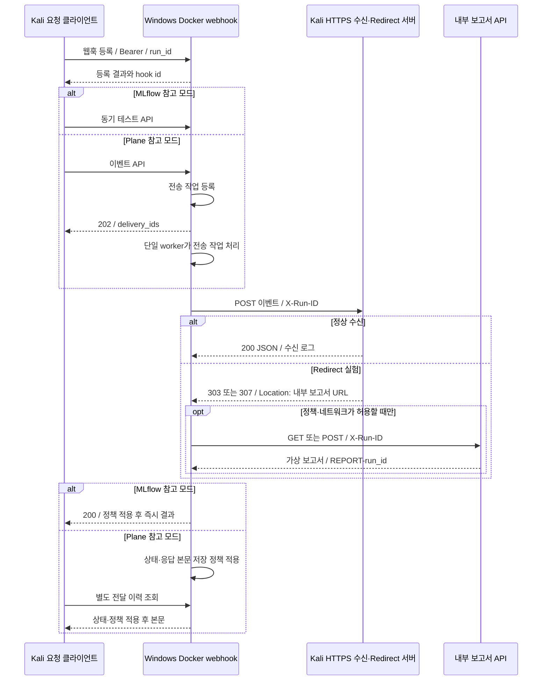

# 예측랩 웹훅 SSRF 실험 — 팀 연동 안내

이 저장소는 가상의 B2B 수요예측 기업 **예측랩**을 배경으로 한 학부 웹 보안 프로젝트다. 고객사가 등록한 웹훅으로 가상 모델 등록·이슈 변경 이벤트를 보내고, Redirect·주소 검증·네트워크·응답 본문 정책에 따라 **내부 API 도달**과 **보고서 노출**이 어떻게 달라지는지 비교한다.

**내부 서버 담당자와 Kali Linux attacker server 담당자는 아래 연동 규약을 기준으로 개발한다.** 현재 `internal`과 Kali 대체 fixture의 최소 구현도 제공되므로 이를 확장하거나 동일한 입출력을 유지하는 구현으로 교체한다. 이 문서의 ‘필수’는 현재 웹훅 구현·검증 실행기와의 호환 조건이며, ‘인계’는 각 담당자가 팀에 공유해야 할 결과물이다.

실제 MLflow·Plane 제품을 설치한 프로젝트가 아니다. MLflow v3.13.0의 동기 테스트 결과 반환, Plane v1.3.1의 비동기 전달·로그 조회 경로를 참고한 **독립적인 두 모의 모드**다. 취약 기준선은 이 프로젝트의 실험 조건이며 실제 제품 버전의 취약점 존재를 의미하지 않는다.

| 문서 | 용도 |
|---|---|
| [LAB.md](docs/LAB.md) | 전체 API, 설정, 실행 절차, VM 이전, 알려진 제한 |
| [REFERENCES.md](docs/REFERENCES.md) | 실제 제품에서 참고한 코드와 단순화한 범위 |
| [VERIFICATION.md](docs/VERIFICATION.md) | Docker 검증 결과와 해석상 주의점 |
| [docker-matrix.json](docs/verification/docker-matrix.json) | 실행별 run_id·정책·결과·연결 IP 근거 |
| [이전 README 백업](docs/archive/README.before-team-handoff-2026-11-20.md) | 갱신 직전 원문 보존. 현재 규약은 이 문서가 우선 |

## 1. 현재 상태와 역할 분담

2026-11-20 기준 Python 표준 라이브러리·SQLite·단일 비동기 worker 구현과 Docker 검증을 완료했다. 통합 테스트 12개, 정책/네트워크/본문 비교 9개 조합이 통과했고 정상 전송은 18/18건 성공했다. **실제 Kali VM과 별도 Linux VM 두 대의 연동은 아직 완료된 것으로 간주하지 않는다.**

| 담당 | 책임 범위 | 시작할 구현 | 팀에 인계할 내용 |
|---|---|---|---|
| webhook 담당 | 관리 API·권한, 이벤트 생성, 동기/비동기 송신, URL 정책·TLS·IP 검증, 본문 처리·송신 로그 | [webhook/](webhook/), [compose.yaml](compose.yaml) | API 기준 URL, 계정/워크스페이스, 적용 정책, 수신자 예외, 실행별 전송 결과 |
| internal server 담당 | 가상 보고서 API, 보고서 도달 관측, 보호망 배치·데이터 영속화 | [internal/server.py](internal/server.py), [internal/Dockerfile](internal/Dockerfile) | health/보고서/관측 주소, 응답 예시, 동일 run_id의 도달 근거, 허용/차단 네트워크 조건 |
| Kali attacker server 담당 | API 요청 클라이언트, 정상 HTTPS 수신 서버, 고정 목적지 Redirect 서버, 결과 수집·비교 | [fixtures/server.py](fixtures/server.py), [check_lab.py](scripts/check_lab.py) | 수신 origin·실제 IP·CA 공개 인증서, Redirect 목적지/상태 코드, 수신 로그와 실험별 판정표 |

Kali의 attacker 역할은 **팀이 관리하는 실험 대상**에 요청을 만드는 역할이다. 정상 수신 서버와 Redirect 서버도 같은 Kali에 둘 수 있지만 역할과 로그는 구분한다. 내부망에 직접 접속할 수 없는 상태에서도 Redirect 응답은 만들 수 있다.



**Redirect 이후 내부 API를 호출하는 주체는 webhook이다.** Kali가 대신 내부 보고서를 가져와 응답하면 이 프로젝트의 SSRF 경로를 측정한 것이 아니다.

## 2. 모든 담당자가 유지할 공통 규약

### 2.1 기존 통신 API와 송신 API를 구분한다

| 서비스·경로 | 유지할 응답 | 의미 |
|---|---|---|
| webhook `GET /health` | 200, `{"service":"webhook","ok":true}` | webhook 프로세스 상태 |
| webhook `POST /webhook` | 202, `{"service":"webhook","accepted":true}` | `{"event":"connectivity-check"}` 수신 확인. JSON 1~4096바이트 |
| internal `GET /health` | 200, `{"service":"internal","ok":true}` | 기존 probe가 비교하는 내부 서비스 응답 |

webhook의 `/webhook`은 외부로 전송을 시작하는 API가 아니다. 이벤트 **송신**은 `/api/workspaces/...`의 테스트·이벤트 API로 실행한다. health 성공만으로 내부 보고서 도달 또는 정상 웹훅 수신을 판단하지 않는다.

### 2.2 run_id·워크스페이스·보고서 식별자

- 실험 클라이언트가 실행마다 새 UUID `run_id`를 생성한다. 같은 실행의 등록·전송·수신·내부 관측·결과 조회에는 그 값을 그대로 사용한다. 모드/정책/네트워크/본문 조건이 바뀌면 새 UUID를 쓴다.
- 관리 API의 등록·테스트·이벤트 JSON에 `run_id`를 명시한다. 생략하면 서버가 별도 UUID를 만들므로 팀 실험에서는 명시하는 것을 원칙으로 한다.
- 송신 HTTP 헤더는 `X-Run-ID: <UUID>`, 이벤트 JSON에도 `run_id`가 있다. Redirect 서버는 Location의 query에도 URL 인코딩한 `run_id`를 보존한다.
- 보고서 본문에 **`report_marker: "REPORT-<동일 UUID>"`**와 `run_id`, `fictional: true`를 넣는다. 실제 고객 정보·계약 정보·운영 비밀은 사용하지 않는다.
- 하나의 run_id를 다른 워크스페이스에 재사용하지 않는다. workspace ID, webhook ID, delivery ID와 run_id는 서로 다른 식별자다.
- 현재 보고서의 `alpha`/`beta`는 가상 고객사 키다. 검증 실행기가 새로 만든 UUID workspace ID와 일치해야 하는 값이 아니다. 보고서 경로와 고객사 매핑을 바꾸려면 먼저 합의한다.

현재 송신 이벤트 형태는 다음과 같다. 두 서버 담당자는 HTTP 메서드·헤더·원문 payload를 수신 가능한 상태로 유지한다.

```json
{
  "run_id": "11111111-1111-4111-8111-111111111111",
  "event": "model.registered",
  "workspace_id": "alpha",
  "webhook_id": "<등록 응답 id>",
  "data": {"fictional": true, "company": "예측랩", "model": "demand-demo-v1", "issue": "DEMO-1", "status": "updated"}
}
```

이벤트는 `model.registered`, `issue.updated` 두 종류다. webhook은 고정된 Content-Type·User-Agent·X-Run-ID를 보내며 **관리 API의 Bearer 토큰이나 고객 인증 쿠키를 목적지에 전달하지 않는다.** 내부/수신 API에 해당 토큰을 요구하면 현재 송신 계약과 맞지 않는다.

## 3. internal server 담당자: 구현·준수·인계 항목

### 3.1 필수 API 계약

| 메서드·경로 | 요구 사항 |
|---|---|
| `GET /health` | 위의 정확한 200 JSON 유지. 보고서 도달 기록을 만들지 않음 |
| `GET /reports/alpha`, `/reports/beta` | 유효한 run_id를 받고 200 가상 보고서 JSON 반환 |
| `POST /reports/alpha`, `/reports/beta` | GET과 같은 보고서 계약. 307/308 Redirect 이후 POST·본문을 받을 수 있어야 함 |
| `GET /observations?run_id=<UUID>` | 해당 실행의 **보고서 핸들러 도달 기록만** 반환. 조회 자체가 도달 기록을 만들면 안 됨 |

보고서 요청의 run_id는 **X-Run-ID 헤더 우선, 없을 때 query의 run_id**를 사용한다. 현재 구현은 헤더 값이 잘못되면 유효한 query가 있어도 400을 반환한다. 유효하지 않은 고객사 키/UUID는 400, 정의하지 않은 경로는 404다. POST는 현재 최대 16384바이트의 요청 본문을 수용한다. 응답에는 적절한 Content-Type과 정확한 Content-Length를 제공한다.

보고서 최소 구조는 아래와 같다. 모델·계약의 가상 값은 확장할 수 있지만 marker와 run_id는 그대로 유지한다. 현재 limit 비교 실행기는 `report_marker`가 본문 첫 필드인 JSON 형식을 전제로 marker 위치를 계산하므로, 필드 순서·직렬화 형식을 변경하면 실행기도 함께 맞춰야 한다.

```json
{
  "report_marker": "REPORT-11111111-1111-4111-8111-111111111111",
  "run_id": "11111111-1111-4111-8111-111111111111",
  "fictional": true,
  "customer": "alpha",
  "model_operations": {"active_models": 3, "last_model": "demand-demo-v1"},
  "contract_summary": {"plan": "demo-enterprise", "annual_credits": 12000}
}
```

관측 API는 현재 실행기와 같은 필드·배열 순서를 유지한다. `requests`의 각 원소는 **[run_id, method, path, created]**다. 미도달은 `internal_api_reached=false`, `requests=[]`이며, 시간은 UTC 기준임을 명시한다.

```json
{
  "run_id": "11111111-1111-4111-8111-111111111111",
  "internal_api_reached": true,
  "requests": [["11111111-1111-4111-8111-111111111111", "GET", "/reports/alpha", "2026-11-20 00:00:00"]]
}
```

**도달 기록은 보고서 요청을 받은 시점에 남긴다.** webhook이 본문을 버리거나 호출자가 조회하지 않아도 내부 도달은 true다. 연결이 중간에 끊겨도 이미 받은 보고서 요청을 false로 되돌리지 않는다. 콘솔에는 service·run_id·method·path를 기록하고, 영속 관측에는 UTC 시각을 남긴다.

### 3.2 배치와 저장 조건

- Docker 단계에서는 internal을 `protected`에만 연결하고 호스트 포트를 게시하지 않는다. `/observations`도 같은 내부망/관측 경로에만 둔다. 이 관측 API는 현재 인증 없는 실험 도구다.
- 기존 [probe.py](webhook/probe.py)는 `INTERNAL_HEALTH_URL`의 JSON까지 비교한다. health의 service 이름이나 응답 필드를 임의로 바꾸지 않는다.
- SQLite는 `INTERNAL_DB_PATH`로 지정한다. 현재 Compose 값은 `/data/internal.sqlite3`다. UID/GID `10001:10001`이 `/data`와 WAL/SHM에 쓸 수 있어야 하며 루트 파일시스템은 읽기 전용이다.
- 실제 내부 VM으로 옮길 때 IP·포트·DB 경로는 설정으로 주입한다. 현재 컨테이너 DNS `internal`을 VM 사이에서 자동 사용할 수 있다고 가정하지 않는다.
- 기본 내부 API는 HTTP다. strict의 HTTPS→HTTP 거부를 내부 IP 검증 결과와 혼동하지 않도록 실제 차단 사유를 함께 기록한다. 내부 HTTPS를 추가한다면 원래 health/probe 계약, CA 배포와 테스트 조건을 먼저 협의한다.
- 내부 API에 새 인증을 붙이거나 보고서 내용을 마스킹하는 것은 별도 실험 조건이다. 현재 기준선은 **네트워크로 격리한 가상 레거시 API**이므로 묵시적으로 계약을 바꾸지 않는다.

### 3.3 내부 담당자 완료·인계 기준

- [ ] GET/POST 보고서와 잘못된 UUID·고객사 요청의 상태 코드/JSON 예시 제공
- [ ] X-Run-ID 우선순위와 REPORT-run_id 일치 확인
- [ ] 동일 run_id의 콘솔 로그·영속 기록·관측 API 결과 제공
- [ ] 재기동 후 관측 기록 유지, `/data` 소유권·쓰기 가능 확인
- [ ] 기본 망에서 webhook→internal 도달, 차단 망에서 미도달 확인
- [ ] 실제 보고서 URL, 관측 경로, health URL, 실행 방법, 프로토콜 변경 여부 공유

## 4. Kali attacker server 담당자: 구현·준수·인계 항목

### 4.1 요청 생성 클라이언트와 계정

관리 요청은 `Authorization: Bearer <실험 토큰>`과 JSON을 사용한다. 현재 예제 계정은 [accounts.json](config/accounts.json)에 있다.

| 계정 | 권한·사용 목적 |
|---|---|
| alice / `lab-alice-token` | alpha 관리자. 등록·전송·이력 조회 |
| bob / `lab-bob-token` | beta 관리자. alpha 설정·이력에 접근하면 403이어야 함 |
| viewer / `lab-viewer-token` | alpha 일반 멤버. 웹훅 조회만 허용, 설정 변경·송신·로그 조회는 403 |
| customer / `lab-customer-token` | 워크스페이스 생성 후 그 공간 관리자. 자동 검증 실행기가 사용 |
| operator / `lab-operator-token` | 모든 공간에 접근하는 내부 운영자. 일반 고객 권한 실험에 사용하지 않음 |

이 값들은 공개 가상 계정 토큰이다. 실제 자격 증명으로 교체한 파일이나 토큰은 저장소에 올리지 않는다.

연동에 필요한 최소 API 흐름:

| 단계 | API | 확인할 결과 |
|---|---|---|
| 계정 확인 | `GET /api/me` | 계정·멤버십 |
| 선택: 자신의 공간 생성 | `POST /api/workspaces` / `{"name":"가상 고객사"}` | 201, 생성자가 admin |
| 등록 | `POST /api/workspaces/{ws}/hooks` | 201 및 hook id, URL 거부 시 400과 decision/run_id |
| MLflow 참고 실험 | `POST /api/workspaces/{ws}/hooks/{id}/test` | 동기 200 API 응답의 `result.status`, `result.body`, `result.outcome` |
| Plane 참고 실험 | `POST /api/workspaces/{ws}/events` | 202와 delivery_ids. **전달 완료 판정 아님** |
| Plane 결과 확인 | `GET /api/workspaces/{ws}/deliveries?run_id={uuid}` | queued/sending 이후 완료 상태와 저장·조회 정책 적용 본문 |
| 실행 전체 확인 | `GET /api/workspaces/{ws}/runs/{uuid}` | 전송 이력·정책 판정·감사 로그 |

등록 본문은 `{"name":"정상 수신","url":"<수신 URL>","events":["model.registered","issue.updated"],"run_id":"<UUID>"}`다. 동기 테스트는 `{"event":"model.registered","run_id":"<UUID>"}`, 비동기 이벤트는 `{"event":"issue.updated","run_id":"<UUID>"}`다. 반드시 구독한 이벤트를 사용한다.

비동기 이벤트는 **해당 공간의 모든 구독 웹훅**으로 전송된다. 정상·Redirect 실험이 섞이지 않도록 전용 공간을 사용하거나 실험 후 `DELETE /api/workspaces/{ws}/hooks/{id}`로 정리한다. 완료 상태는 `succeeded`, `failed`, `blocked`, `interrupted`이며 오류·trace도 확인한다. 401/403은 요청자 권한 문제, 관리 API의 200/202와 원격 수신 HTTP 상태는 별개다.

### 4.2 정상 HTTPS 수신 서버와 Redirect 서버

현재 자동 실행기는 **하나의 receiver origin 아래 `/webhook`과 `/redirect`**를 전제로 한다. 프로세스·포트를 분리하려면 URL 설정과 실행기를 함께 조정한다. 기본 시작점은 [fixtures/server.py](fixtures/server.py)다.

| 경로·동작 | 필수 계약 |
|---|---|
| `POST /webhook` | JSON 이벤트를 수신·기록하고 200 JSON 반환. X-Run-ID·본문 run_id를 보존 |
| `GET /health` | 수신 서버 자체 상태 확인. fixture 응답은 `{"service":"fixture","ok":true}` |
| `/redirect` | 최초 POST를 수신한 뒤 **고정된 실험 보고서 URL**을 Location으로 반환. 기본 303, 필요 시 301/302/307/308 선택 |
| `GET /observations?run_id=<UUID>` | `{"requests":[...]}`. 원소 순서는 **[run_id, path, method, raw_body]**. 현재 실행기는 정상 전달 시 요청 1개를 기대 |

Redirect 구현 시 지켜야 할 사항:

1. 요청 본문을 읽은 뒤 상태·Location·정확한 Content-Length(빈 본문이면 0)를 반환한다. 내부 API에 직접 요청하는 프록시로 만들지 않는다.
2. Location에 `run_id` query를 URL 인코딩해 붙인다. 기존 query가 있으면 `&`를 사용한다. 목적지는 환경변수/설정의 `REPORT_API_URL`에서 읽는다.
3. webhook은 301/302/303에서 POST를 GET으로 바꾸고, 307/308에서는 POST·본문을 유지한다. 내부 담당자가 양쪽 메서드를 구현해야 한다.
4. 선택 확장 `/relative`, `/loop`, `/large`, `/fail`은 각각 상대 Location·반복 이동·대형 응답·503 비교용이다. 현재 fixture에 포함돼 있다.
5. 관측은 run_id, 수신 경로, 메서드, 원문 payload를 보존한다. health/관측 조회를 정상 웹훅 수신 건수에 섞지 않는다.

Kali 예시 실행(변수 값은 실제 환경에서 결정):

```bash
export REPORT_API_URL='http://internal:8000/reports/alpha'
python3 fixtures/server.py --host 0.0.0.0 --port 8443 \
  --target "$REPORT_API_URL" --cert "$RECEIVER_CERT" --key "$RECEIVER_KEY"
```

Docker 단계의 위 Location 이름은 **webhook 컨테이너가 해석**한다. Kali에서 `internal`이 해석되지 않아도 Redirect 생성은 가능하다. 네트워크 차단 비교에서는 webhook 담당자가 제공한 내부 컨테이너의 **숫자 IP**를 사용해 DNS 실패와 실제 연결 제한을 구분한다. VM 이전 뒤에는 내부 VM의 실제 주소로 바꾼다.

### 4.3 HTTPS·사설 주소 예외·통신 조건

- Kali의 실제 수신 IP/port, hostname, 정상 URL(`/webhook`), Redirect URL(`/redirect`), **CA 공개 인증서**를 webhook 담당자에게 제공한다. 수신 서버 개인키는 Kali에서 관리한다. 저장소의 테스트 개인키는 공개된 폐기용 fixture 키이며 실제 Kali 서비스용으로 재사용하지 않는다.
- 수신 URL hostname과 인증서 SAN이 일치해야 한다. IP URL이면 IP SAN이 필요하다. `curl -k`나 인증서 검증 해제를 완료 조건으로 삼지 않는다.
- hostname은 Windows 자체뿐 아니라 **webhook 컨테이너 안에서도** 실제 Kali IP로 해석돼야 한다. 필요한 DNS/컨테이너 hosts 설정을 함께 합의한다.
- 사설 수신자는 예외가 없으면 정상 등록도 거부된다. webhook 담당자가 **정확한 scheme + hostname + port와 실제 IP /32(IPv6 /128)**만 허용한다. 내부 보고서 주소·사설망 전체를 예외에 포함하지 않는다. HTTP와 HTTPS origin은 별도 예외다.
- 기본 `strict` + 본문 `mask`에서는 내부 Redirect 보고서가 보이지 않는 것이 예상 결과다. 취약 기준선 실험은 정책·본문·네트워크 조건을 webhook 담당자와 맞춘 뒤 실행한다.
- Kali→Windows 게시 포트와 Windows Docker webhook→Kali 수신 포트는 서로 반대 방향의 연결이다. 양쪽 경로를 각각 확인한다. Kali 방화벽이 보게 되는 송신 원본은 Docker Desktop NAT 때문에 Windows 호스트 주소일 수 있으므로 실제 접속 로그로 확인한다.

### 4.4 Kali 담당자 완료·인계 기준

- [ ] 동일 UUID로 등록·테스트·이벤트·로그 조회를 연결한 요청 스크립트 제공
- [ ] 정상 HTTPS 수신, 수신 횟수·payload·run_id 기록 확인
- [ ] 303/307 Redirect와 Location·run_id 유지 확인
- [ ] CA 공개 인증서·SAN·실제 수신 IP·origin·목적지 설정 공유
- [ ] bob/viewer/인증 없는 요청의 권한 거부 확인. operator로 우회하지 않음
- [ ] 내부 담당자의 도달 기록과 MLflow 즉시 결과/Plane 이력 본문을 나눠 결과표 작성
- [ ] 기준선·방어·본문 제한 실험의 조건/오류/로그 근거 공유

## 5. 연결 전 세 담당자가 확정할 환경값

실제 값은 각 환경의 설정 파일로 관리한다. 아래 placeholder나 Docker 기본값을 실제 VM 주소로 오인하지 않는다.

| 합의할 값 | 제공·설정 담당 | 적용 위치·주의 |
|---|---|---|
| webhook 기준 URL | webhook | Kali의 관리 API 요청. Windows 단계는 `WEBHOOK_BIND_IP` + `WEBHOOK_HOST_PORT` |
| 정상 receiver origin·실제 IP | Kali → webhook | `RECEIVER_URL`은 실행기의 origin. 정확한 IP 예외와 DNS도 별도 설정 |
| 보고서 전체 URL | internal → Kali/webhook | `REPORT_API_URL`은 fixture의 Location·검증 대상 설정. 이 변수 자체가 webhook의 내부 접근을 허용하는 스위치는 아님 |
| 내부 health URL | internal → webhook | `INTERNAL_HEALTH_URL`, 기존 probe용 |
| 내부 관측 경로 | internal + 실험 담당 | `/observations`. 보호망 내부 verifier 또는 내부 담당자의 컨테이너 조회 사용 |
| CA 공개 인증서·hostname SAN | Kali → webhook | `CA_FILE`은 webhook 컨테이너 **내부 경로**. Kali 파일 경로와 혼동하지 않음 |
| 수신자 사설 IP 예외 | webhook, Kali 값 확인 | `URL_EXCEPTIONS_FILE`. 등록과 실제 전송 시 판정에 영향 |
| mode·URL 정책·본문 정책 | webhook, 실험 담당 | `ENABLED_MODES`, `POLICY`, `RETURN_BODY`, `STORE_BODY`, `READ_BODY`, `BODY_LIMIT` |
| timeout·응답 크기 | 전 담당 | 기본 송신 소켓 timeout 3초, 최대 응답 65536바이트. 작은 가상 보고서를 신속하게 응답 |
| 네트워크 조건·run_id·시각 기준 | 전 담당 | 연결/차단 대상, 관측자 예외, 새 UUID, UTC 로그 시각을 실행마다 기록 |

Kali 사설 수신자 예외 예시(주소는 예시이며 실제 값으로 교체):

```json
[{"origin":"https://kali-receiver.lab:8443","cidrs":["192.168.241.50/32"]}]
```

이를 로컬 `config/url-exceptions.kali.local.json`에 두고 `.env`에서 `URL_EXCEPTIONS_FILE=/config/url-exceptions.kali.local.json`, `CA_FILE=/config/kali-ca.local.pem`을 지정할 수 있다. 실제 공개 CA 파일도 해당 위치에 준비한다. 기본 Compose가 [config/](config/)를 `/config`에 읽기 전용으로 mount한다. `.env`, `config/*local*`, DB, 개인 실험 로그는 Git에서 제외한다.

## 6. 팀 합동 검증 순서와 판정 기준

| URL 정책 | 이 프로젝트에서의 의미 |
|---|---|
| baseline | 등록·갱신 URL만 주소 검사. 실제 전송·Redirect 이후의 주소는 검사하지 않는 비교 기준선 |
| reject | 최초 송신 목적지를 재검증하고 검사 IP에 연결. Redirect는 따라가지 않음 |
| strict | 모든 Redirect hop의 주소 검사·검사 IP 연결·실제 peer 확인, HTTPS 인증서/호스트 검증, HTTPS→HTTP 거부 |

HTTPS 인증서·호스트 이름 검증은 baseline/reject에서도 유지한다. 세 정책 모두 등록 시 내부 주소 직접 등록을 기본 거부하며, 운영자가 정한 정상 사설 수신자 예외만 적용한다.

1. **상태·기초 연결**: 두 기본 health와 기존 `/webhook`을 확인하고 probe를 실행한다. Kali에서 관리 API 접근도 확인한다.
2. **정상 HTTPS 우선**: 사설 수신 예외·CA·DNS를 맞추고 두 모드에서 정상 전송과 실제 수신 기록을 확인한다. 이후 모든 방어 조건에서도 이 정상 대조군을 유지한다.
3. **직접 내부 URL 등록**: 내부 보고서 URL 등록을 시도해 거부·run_id·오류를 기록한다. 등록 거부 단계에서 끝났다면 ‘전송 차단’이라고 표현하지 않는다.
4. **Redirect 기준선**: `POLICY=baseline`, 세 본문 정책 full, 내부 연결 허용 상태에서 실행한다. 내부 도달 기록과 각 모드의 본문 노출을 각각 확인한다.
5. **방어 비교**: reject/strict와 내부 네트워크 차단을 각각·조합해서 비교한다. 숫자 IP로 향하는 Redirect도 포함한다. 수신 성공률, 최초 URL, hop별 선택/연결 IP, 상태·오류를 남긴다.
6. **본문 비교**: baseline과 내부 연결은 유지한 채 반환·저장·조회 제한을 한 번에 하나씩 바꾼다. 본문이 없어도 내부 도달 기록은 남아야 한다.
7. **권한·증거 대조**: 타 공간·일반 멤버 로그 접근 거부를 확인하고 동일 run_id로 webhook·Kali·internal 기록을 맞춘다. 실험 후 webhook 정책·네트워크를 기본 설정으로 복구한다.

| 실험 조건 | 내부 도달 | MLflow 즉시 본문 / Plane 조회 본문 | 정상 HTTPS 대조군 |
|---|---|---|---|
| baseline + 내부 연결 + full/full/full | 도달 | marker 노출 / marker 노출 | 성공 |
| reject 또는 strict + full/full/full | 미도달 | 미노출 / 미노출 | 성공 |
| baseline + 내부 네트워크 차단 | 미도달 | 미노출 / 미노출 | 성공 |
| baseline + 연결 + mask/full/full | 도달 | 미노출 / 노출 | 성공 |
| baseline + 연결 + full/mask/full | 도달 | 노출 / 미노출 | 성공 |
| baseline + 연결 + full/full/mask | 도달 | 노출 / 미노출 | 성공 |

본문 조건 순서는 **RETURN / STORE / READ**다. RETURN만 제한하면 MLflow 모드의 별도 이력에는 본문이 남을 수 있다. limit는 앞부분을 남겨 부분 정보가 노출될 수 있으며 marker 미검출만으로 모든 정보가 보호됐다고 주장하지 않는다.

정책 해석에도 주의한다. reject는 최초 목적지 재검증·IP pinning도 포함한다. strict는 모든 hop 검증·pinning과 **HTTPS→HTTP downgrade 거부**를 포함한다. HTTPS 수신자→HTTP 내부 API 경로는 downgrade에서 먼저 막힐 수 있으므로, trace의 실제 차단 사유를 기재한다. 사설 IP 검증 자체를 비교하려면 별도 HTTP→HTTP 실험(origin 예외와 ALLOW_HTTP 포함) 등으로 변수를 통제한다. 기존 통합 테스트에는 그 조건도 포함돼 있다.

결과표에는 최소 **run_id, mode, workspace, URL 정책, 본문 정책, 네트워크 조건, 최초 URL, Redirect 상태·Location, 실제 연결 IP, 원격 상태, 지연·오류, 내부 도달 여부, 호출자 본문 노출 여부, 로그 근거**를 기록한다. 내부/관측 API 장애나 잘못된 CA로 관측이 실패한 경우에는 ‘미도달 성공’ 대신 실험 실패/판정 불가로 남긴다.

## 7. 실행 경로와 Docker/Kali 구분

### 7.1 기본 두 서비스와 기존 연결 확인

Windows PowerShell, 저장소 루트에서 실행한다. Docker Desktop은 Linux 컨테이너 모드여야 한다. Kali 접근 시 `.env`의 bind IP는 Windows VMnet1 실제 IPv4를 사용한다.

```powershell
if (-not (Test-Path .env)) { Copy-Item .env.example .env }
docker compose build
docker compose up -d --no-build --wait
docker compose exec -T webhook python probe.py
```

보호망 분리·복구:

```powershell
docker compose -f compose.yaml -f compose.block.yaml up -d --no-build --wait
docker compose -f compose.yaml -f compose.block.yaml exec -T webhook python probe.py --expect blocked
docker compose up -d --no-build --wait
```

probe는 분리 뒤 DNS 실패로 끝날 수도 있다. 실제 연결 제한 비교에는 별도로 숫자 IP Redirect와 내부 관측 기록을 사용한다.

### 7.2 Kali를 대신하는 Docker fixture로 먼저 재현

```powershell
docker compose -f compose.yaml -f compose.lab.yaml --profile test build
powershell -NoProfile -ExecutionPolicy Bypass -File scripts/prepare-lab.ps1
docker compose -f compose.yaml -f compose.lab.yaml --profile test run --rm --no-deps verifier
powershell -NoProfile -ExecutionPolicy Bypass -File scripts/test-matrix.ps1 -SkipBuild
```

[compose.lab.yaml](compose.lab.yaml)은 receiver와 관측용 verifier를 추가한다. 준비 스크립트는 receiver의 현재 IP **한 개 /32**를 예외로 만든다. IP가 바뀌면 다시 준비한다. matrix는 세 정책×두 네트워크 및 본문 마스킹 세 조건을 검사하고 원래 환경변수·기본 네트워크를 복구한다. 출력 JSON은 Git에서 제외한 `artifacts/`에 생성된다.

**실제 Kali로 바꿀 때 lab override를 그대로 적용하지 않는다.** 이 파일은 webhook의 CA·예외를 Docker receiver용으로 바꾼다. 실제 Kali 실험은 기본 Compose에 Kali용 CA·예외·DNS를 적용한다. Docker fixture 통과와 실제 Kali 통과는 별도 결과다.

### 7.3 관측 경로와 VM 이전

기본 Docker에서 internal은 호스트에 게시되지 않는다. Kali에서 내부 `/observations`를 직접 읽을 수 있다고 가정하지 않는다. 내부 담당자가 `docker compose exec`로 조회해 근거를 넘기거나, 두 망에 연결한 **관측용 실행기**가 조회한다. 관측을 편하게 하려고 내부 API를 무조건 외부에 게시하지 않는다.

[check_lab.py](scripts/check_lab.py)를 실제 Kali/VM에서 실행하려면 `--base`, `--receiver`, `--internal`, `--observer`, `--ca`, 정책·본문 조건을 실제 값으로 전달한다. 이 실행기는 관측 API에 접근할 수 있어야 한다. 도달 경로가 없는 Kali에서 그대로 실행하면 검증이 실패하므로 먼저 관측 경로를 합의한다. VM에서는 webhook의 송신만 제한하고 필요한 관측자 접근은 별도로 한정한다.

이미지·설정을 별도 Linux VM으로 옮기는 절차는 [LAB.md](docs/LAB.md)의 VM 이전 항목을 따른다. 주소·포트·CA 경로를 코드에 고정하지 않고, DB 볼륨 소유권과 VM 방화벽의 실제 적용 경로도 다시 확인한다.

## 8. 브랜치·변경 협의·팀 공유

팀 연동 기준 브랜치는 **`develop/webhook-team-handoff-20261120`**이다. 원격 저장소는 [WebSecuriy/docker](https://github.com/WebSecuriy/docker)다. main에 직접 덮어쓰지 않고, 팀원은 이 기준에서 역할별 feature 브랜치를 만들어 변경한다.

```bash
git fetch origin
git switch --track origin/develop/webhook-team-handoff-20261120
# 내부 담당자 예시: git switch -c feature/internal-report-api
# Kali 담당자 예시: git switch -c feature/kali-receiver-redirect
```

이미 로컬에 같은 develop 브랜치가 있으면 `git switch develop/webhook-team-handoff-20261120` 후 `git pull --ff-only`를 사용한다. 작성 중인 변경이 있는 작업 폴더에서는 먼저 자신의 변경을 보존하고 전환한다.

경로·JSON 필드/배열 순서·marker 직렬화·UUID 규칙·수신 origin·CA·인증 요구·관측 접근 방식·프로토콜을 바꿀 때는 **영향받는 담당자와 먼저 합의**하고 README/설정 예시/검증 실행기도 같이 수정한다. 각 담당자는 위 완료 체크리스트와 실제 run_id 근거를 PR 또는 팀 공유 문서에 첨부한다. 현재 체크리스트의 빈 칸은 실제 팀 연동이 남았다는 뜻이며 Docker fixture 결과로 대신 체크하지 않는다.
