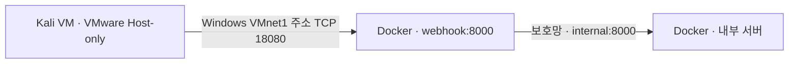

# Webhook Connectivity Lab

VMware의 Kali VM에서 Windows의 웹훅 서버에 접속하고, 웹훅 컨테이너에서 내부 서버에 접속하는 기초 실습이다. Docker Compose로 컨테이너 두 개를 시작하고, 보호망 연결을 분리했을 때 웹훅 수신은 유지되는지 확인한다. 두 서비스는 공식 `python:3.12-slim` 베이스 이미지와 Python 표준 라이브러리를 사용한다.



| 노드 | 역할 | 접속 주소 |
| --- | --- | --- |
| Kali VM | HTTP 요청을 보내는 테스트 클라이언트 | VMware Host-only에 연결 |
| `webhook` | `GET /health`, `POST /webhook` | Kali에서 `http://<Windows VMnet1 IPv4>:18080` |
| `internal` | `GET /health` | 보호망에서 `http://internal:8000` |

Windows는 `webhook`의 컨테이너 포트 `8000`만 호스트 포트 `18080`으로 게시한다. `internal`은 Docker의 `protected` 네트워크에만 속하며 호스트에 게시된 포트가 없다. `compose.block.yaml`을 적용하면 `webhook`이 `protected`에서 빠진다. Windows 방화벽의 인바운드 규칙은 Kali에서 Windows에 들어오는 구간을 제어한다. [Docker Compose 네트워크](https://docs.docker.com/compose/how-tos/networking/) · [Docker Desktop 포트 매핑](https://docs.docker.com/desktop/features/networking/)

## 저장소 구조

```text
.
├── README.md
├── compose.yaml          # 기본 연결 구성
├── compose.block.yaml    # 웹훅 컨테이너를 보호망에서 분리하는 설정
├── .env.example          # PC별 접속 주소 및 포트 예시
├── .gitignore
├── .gitattributes
├── webhook/
│   ├── Dockerfile
│   ├── server.py         # 웹훅 수신 및 상태 확인
│   └── probe.py          # 컨테이너에서 내부 서버 접속 확인
└── internal/
    ├── Dockerfile
    └── server.py         # 내부 서버 상태 확인
```

## 준비 및 배포

Windows에 Git과 Docker Desktop이 필요하다. Docker Desktop을 켠 뒤 `docker info --format '{{.OSType}}'`의 출력이 `linux`인지 확인한다. 보호망 분리 기능을 사용하려면 `docker compose version`이 2.24.4 이상이어야 한다. Kali VM은 VMware에서 **Host-only** 어댑터에 연결한다. [Compose 파일 병합](https://docs.docker.com/reference/compose-file/merge/) · [VMware Host-only](https://knowledge.broadcom.com/external/article/309842/understanding-networking-types-in-hosted.html)

1. Windows PowerShell에서 저장소를 내려받는다. `OWNER`와 `REPO`를 실제 값으로 바꾼다. 이미 프로젝트 폴더가 있으면 그 폴더에서 `.env` 설정부터 진행한다.

   ```powershell
   git clone https://github.com/OWNER/REPO.git
   cd REPO
   ```

2. `.env`를 준비하고 Windows에서 `ipconfig`를 실행한다. **VMware Network Adapter VMnet1**의 IPv4를 `.env`의 `WEBHOOK_BIND_IP`에 입력한다. Kali에서 `ip -br -4 addr`를 실행해 같은 서브넷에 연결됐는지 확인한다.

   ```powershell
   if (-not (Test-Path .env)) { Copy-Item .env.example .env }
   notepad .env
   ```

   VMnet1 주소가 `192.168.241.1/24`라면 아래와 같이 설정한다. 주소에는 `/24`를 붙이지 않는다. `127.0.0.1` 기본값을 사용하면 Windows에서 로컬 점검을 할 수 있다. 이어지는 명령 예시에서도 각 PC의 VMnet1 주소와 설정한 포트를 사용한다.

   ```dotenv
   WEBHOOK_BIND_IP=192.168.241.1
   WEBHOOK_HOST_PORT=18080
   ```

3. Compose 설정을 확인하고 이미지를 빌드한다. `docker compose config` 출력에서 `webhook`의 `host_ip`가 VMnet1 주소와 일치하는지 확인한다. 베이스 이미지를 처음 받는 단계에는 인터넷 연결이 필요하다.

   ```powershell
   docker compose config
   docker pull python:3.12-slim
   docker compose build
   docker compose up -d --no-build --pull never --wait
   docker compose ps
   ```

   `up`은 빌드한 로컬 이미지로 실행하고 두 서비스의 상태 확인을 기다린다. `docker compose ps`에서 `webhook`과 `internal`이 각각 `healthy`인지 확인한다. [Docker Compose up](https://docs.docker.com/reference/cli/docker/compose/up/)

## 통신 확인

Windows PowerShell에서 웹훅 응답과 웹훅 → 내부 서버 통신을 확인한다.

```powershell
docker compose port webhook 8000
curl.exe --noproxy '*' -fsS http://192.168.241.1:18080/health
docker compose exec -T webhook python probe.py
```

`probe.py`는 `internal:8000/health`에서 내부 서비스의 응답을 받으면 `PASS`를 표시한다. 각 컨테이너가 `healthy`라는 사실은 해당 컨테이너 안에서 상태 응답을 받았다는 뜻이다. 컨테이너 간 도달 여부는 `probe.py`의 결과로 확인한다.

Kali에서 Windows VMnet1 주소로 요청한다.

```bash
curl --noproxy '*' --connect-timeout 3 -fsS http://192.168.241.1:18080/health
curl --noproxy '*' --connect-timeout 3 -fsS -i \
  -H 'Content-Type: application/json' \
  --data '{"event":"connectivity-check"}' \
  http://192.168.241.1:18080/webhook
```

`GET /health`는 HTTP `200`과 `{"service":"webhook","ok":true}`를 반환한다. `POST /webhook`은 HTTP `202`를 반환한다.

내부 컨테이너가 먼저 요청을 보내는 역방향 연결도 확인하려면 기본 구성에서 아래를 실행한다. 요청은 Docker 보호망 안에서 서비스 이름 `webhook`으로 전달된다.

```powershell
docker compose exec -T internal python -c "from urllib.request import urlopen; r = urlopen('http://webhook:8000/health', timeout=3); print(r.status, r.read().decode())"
```

## 보호망 분리 확인

Windows에서 두 Compose 파일을 적용한다.

```powershell
docker compose -f compose.yaml -f compose.block.yaml up -d --no-build --pull never --wait
docker compose -f compose.yaml -f compose.block.yaml ps
docker compose -f compose.yaml -f compose.block.yaml exec -T webhook python probe.py --expect blocked
```

두 컨테이너가 `healthy`인 상태에서 `PASS: internal service unreachable`이 예상된다. Docker 서비스 이름을 확인하는 이 테스트에서는 네트워크 분리 후 이름 해석 실패가 발생할 수 있다. 이어서 Kali의 `/health`를 다시 호출해 `200`을 확인한다. 두 확인을 함께 해야 웹훅 서버 전체의 종료를 차단으로 오인하지 않는다.

| 확인 경로 | 기본 구성 | 보호망 분리 구성 |
|---|---|---|
| Kali → 웹훅 `/health` | 200 | 200 |
| Kali → 웹훅 `/webhook` | 202 | 202 |
| 웹훅 컨테이너 → 내부 `/health` | 200 | 도달 실패 |
| Kali → 내부 컨테이너 | 게시된 포트 없음 | 게시된 포트 없음 |

웹훅이 내부망에 다시 연결되는 기본 구성으로 복귀한다.

```powershell
docker compose up -d --no-build --pull never --wait
docker compose exec -T webhook python probe.py
docker compose logs --tail 20 webhook internal
```

## 업데이트 및 종료

코드를 수정했거나 저장소에서 변경 사항을 내려받았으면 서비스 이미지를 다시 빌드한다.

```powershell
git pull --ff-only
docker compose build
docker compose up -d --no-build --pull never --wait
```

실험을 종료할 때 `docker compose down`을 실행한다.

## 문제 해결

| 증상 | 확인할 내용 |
| --- | --- |
| `can't bind on the specified endpoint` | `docker compose config`의 `host_ip`를 `ipconfig`의 VMnet1 IPv4와 대조한다. 예를 들어 `192.158.241.1`과 `192.168.241.1`은 서로 다른 주소다. 주소가 맞으면 `Get-NetTCPConnection -LocalPort 18080 -State Listen`으로 포트 사용 여부를 확인한다. |
| `.env`를 수정했는데 다른 주소가 적용됨 | `docker compose config --environment`로 값을 확인한다. 현재 PowerShell에 같은 이름의 환경변수가 있으면 `.env`보다 먼저 적용된다. |
| Windows에서는 되지만 Kali에서 연결 실패 | VMware 어댑터 연결, Kali의 IPv4와 서브넷을 확인한다. Windows 인바운드 허용 규칙이 필요하면 VMnet1 주소·포트와 Kali 주소로 범위를 한정한다. |
| `--pull never`로 기동할 때 이미지가 없다고 나옴 | 베이스 이미지 다운로드 후 `docker compose build`를 실행한다. |
| 컨테이너 상태가 `unhealthy` | `docker compose ps -a`와 `docker compose logs --tail 50 webhook internal`을 확인한다. |

[Compose 환경변수 우선순위](https://docs.docker.com/compose/how-tos/environment-variables/variable-interpolation/) · [Windows 방화벽 규칙](https://learn.microsoft.com/en-us/powershell/module/netsecurity/new-netfirewallrule)

## GitHub 최초 업로드

GitHub에 빈 저장소를 만들고 이 폴더를 저장소 루트로 사용한다. 이 README와 `.gitignore`가 이미 있으므로 GitHub에서 초기 파일 생성을 선택하지 않는다. `.env`는 PC별 설정 파일로 두고 `.env.example`을 공유한다. VMware 디스크 파일은 이 저장소의 배포에 필요하지 않다. [GitHub에 로컬 소스 추가](https://docs.github.com/en/migrations/importing-source-code/using-the-command-line-to-import-source-code/adding-locally-hosted-code-to-github?platform=windows)

```powershell
git init -b main
git add -- README.md compose.yaml compose.block.yaml .env.example .gitignore .gitattributes webhook/ internal/
git diff --cached --name-only
git commit -m "Add webhook connectivity lab"
git remote add origin https://github.com/OWNER/REPO.git
git remote -v
git push -u origin main
```

이미 커밋이 있는 GitHub 저장소를 사용한다면 그 저장소를 먼저 `git clone`하고 이 프로젝트의 파일을 옮겨 커밋한다.
